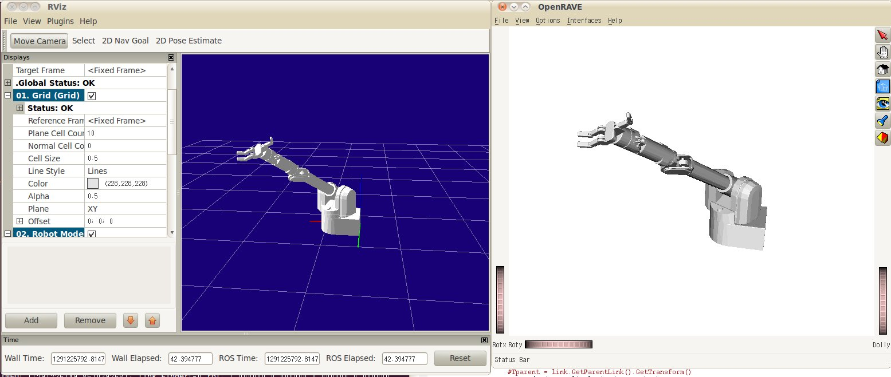

## urdf_to_collada command-line tool

The urdf_to_collada tool will convert `.urdf` files into COLLADA
`.dae` files.

Usage:


```
rosrun collada_urdf urdf_to_collada <input-urdf> <output.dae>
```


Example:


```
rosrun collada_urdf urdf_to_collada pr2.urdf pr2.dae
```


### Limitations

- Only binary STL mesh geometries are supported
- Mesh scale is not exported
- Materials are not exported

## collada to urdf command-line tool

Usage:


```
rosrun collada_urdf collada_to_urdf <input.dae> <output.urdf>
```

## Tutorials

- [Exporting URDF to COLLADA](#exporting-urdf-to-collada):
  This tutorial teaches you how to export an
  [URDF](https://index.ros.org/p/urdf) file to a COLLADA document
- [Working Directly with COLLADA](#working-directly-with-collada):
  This tutorial shows how to visualize COLLADA XML files and use the in
  the ROS system as an alternative to URDF XML files.

## Exporting URDF to COLLADA

- **Note:** This tutorial assumes you have already
  [created your own URDF file](https://index.ros.org/p/urdf) or that you
  are working with the existing PR2 URDF file.
- **Description:** This tutorial teaches you how to export an
  [URDF](https://index.ros.org/p/urdf) file to a COLLADA document
- **Tutorial Level:** BEGINNER

### Building collada_urdf


```
$ rosdep install collada_urdf
```

 This will install all the external dependencies
for `collada_urdf`. To build the package, run:


```
$ rosmake collada_urdf
```


### Using in your code

First, add the package as a dependency to your manifest.xml file:


```
<package>
    ...
    <depend package="collada_urdf" />
    ...
</package>
```


To start using the exporter in your C++ code, include the following
file:


```cplusplus
#include <collada_urdf/collada_urdf.h>
```

 Now there are different ways to proceed. You
can construct a COLLADA Document Object Model (DOM) from URDF in a
variety of ways:

#### From a file


```cplusplus
boost::shared_ptr<DAE> dom;
if (!collada_urdf::colladaFromUrdfFile("filename.urdf", dom)) {
    ROS_ERROR("Failed to construct COLLADA DOM");
    return false;
}
```


To create the PR2 URDF file, run the following command:


```
$ rosrun xacro xacro.py `rospack find pr2_description`/robots/pr2.urdf.xacro > pr2.urdf
```


#### From the parameter server


```cplusplus
boost::shared_ptr<DAE> dom;
ros::NodeHandle node;
std::string robot_desc_string;
node.param("robot_description", robot_desc_string, std::string());
if (!collada_urdf::colladaFromUdfString(robot_desc_string, dom)) {
    ROS_ERROR("Failed to construct COLLADA DOM");
    return false;
}
```


#### From an XML document


```cplusplus
boost::shared_ptr<DAE> dom;
TiXmlDocument xml_doc;
xml_doc.Parse(xml_string.c_str());
xml_root = xml_doc.FirstChildElement("robot");
if (!xml_root) {
    ROS_ERROR("Failed to find robot element in XML document");
    return false;
}
if (!collada_urdf::colladaFromUrdfXml(xml_root, dom)) {
    ROS_ERROR("Failed to construct COLLADA DOM");
    return false;
}
```


#### From an URDF model


```cplusplus
boost::shared_ptr<DAE> dom;
urdf::Model my_model;
if (!my_model.initXml(....)) {
    ROS_ERROR("Failed to parse URDF robot model");
    return false;
}
if (!collada_urdf::colladaFromUrdfModel(my_model, dom)){
    ROS_ERROR("Failed to construct COLLADA DOM");
    return false;
}
```


#### Writing COLLADA to file

Once you have your COLLADA document loaded, you can write the document
to a file:


```cplusplus
collada_urdf::colladaToFile(dom, "filename.dae");
```


For more details, take a look at the
[API documentation](http://www.ros.org/doc/api/collada_urdf/html/namespacecollada__urdf.html).

## Working Directly with COLLADA

- **Description:** This tutorial shows how to visualize COLLADA XML
  files and use the in the ROS system as an alternative to URDF XML
  files.
- **Keywords:** collada
- **Tutorial Level:** BEGINNER

The urdf package can open COLLADA files directly. This makes it possible
to set a COLLADA document as the robot in the parameter server, and have
it visualized in rviz.

To get a sample collada file of the Barrett WAM:


```
rosrun openrave openrave -save barrettwam.dae robots/barrettwam.robot.xml
```


This command converts a robot from the openrave repository into a
COLLADA file. To visualize this file in rviz:


```
roslaunch orrosplanning collada_rviz_display.launch model:=barrettwam.dae
```


The launch file first puts the COLLADA file directly on the ROS
parameter server. Then it starts
orrosplanning/collada_joint_publisher.py to publish the TF frames.
Finally it starts rviz showing the robot.


